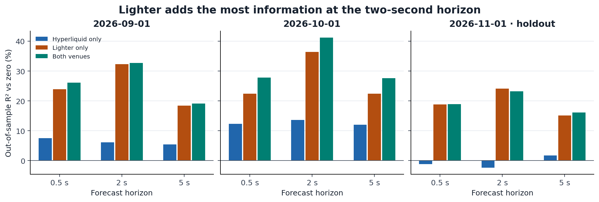

# Event-Driven MM

A Rust recorder and replayer for one public Hyperliquid `l2Book` subscription.

## Run a capture and replay it

With a stable Rust toolchain installed, run these commands from the project root. Choose a new journal path for each capture.

```sh
cargo run --locked -- capture --coin BTC --duration-secs 30 --log btc.jsonl > live.csv
cargo run --locked -- replay --log btc.jsonl > replay.csv
test -s live.csv && cmp live.csv replay.csv
```

Standard output contains `local_time_unix_ms,mid_price` rows without a header. Each usable snapshot produces a row, including snapshots where the midpoint stays the same. A snapshot needs bid and ask levels with positive prices and sizes and a best bid below the best ask. Diagnostics go to stderr. The capture duration starts when the client queues the subscription. At the end of the capture, it waits up to one second for the WebSocket close response. If the peer closes first, the journal records the close and the capture ends.

## Data flow

The network thread uses Mio to drive nonblocking TCP, TLS, and WebSocket I/O. The command queue wakes the reactor after publishing a command. The reactor appends each outbound HTTP request or WebSocket message to the journal before sending it and preserves partial writes across readiness notifications. The reactor also records a strategy timer once per second and separate timers for order deadlines and Hyperliquid heartbeats. Timer records include the scheduled time, firing time, and skipped intervals after a delay.

The main thread follows the file-backed queue, passes records to the order book, and prints midpoint rows. The queue waits at temporary EOF, including after a partial record, and drains remaining records once the network worker has exited. Replay runs the same processing loop against a completed journal with fresh state and no network worker.

## Journal format

The journal is newline-delimited JSON. The first record, `session_start`, has sequence zero and stores the format version, endpoint, and coin. Each subsequent record includes a sequence number, `local_time_unix_ms`, `connection_id`, and an event type. File order is authoritative even if timestamps move backward.

TCP events include addresses, connection failures, or the close reason. HTTP events store the raw request and response heads as text or Base64 if a head contains non-UTF-8 bytes. WebSocket events identify their direction and opcode. Public capture preserves the original text payload, and non-text payloads are arrays of byte values. The journal captures application messages above TLS. Appending makes records available to the reader through the filesystem. Signed actions also use an explicit sync before dispatch.

## Latency measurements

Pass `--latency` to `capture` or `order-test` to print sample counts and approximate p50, p95, and p99 upper bounds in nanoseconds to stderr. The measurements cover kernel receive batch to read return, read to decode, journal append to engine consumption, intent enqueue to first socket write, and the signed-action journal sync.

New v3 journals record optional receive timing on HTTP responses and WebSocket messages. On Linux, the reactor requests software timestamps via `SO_TIMESTAMPING` and reads them through `recvmsg`. The timestamp belongs to the read batch that completed the TLS record needed by the message. TCP and TLS can combine multiple messages into one receive batch, so treat the kernel value as an estimate of local receive-to-read delay. macOS provides userspace timing. The summary counts missing samples and invalid wall-clock deltas as unavailable.

## Testnet order lifecycle

Use an isolated, funded Hyperliquid testnet account and its approved API wallet. Set `HYPERLIQUID_TESTNET_AGENT_KEY` in your environment and use the account's public address for `--account`. Choose explicit size and price for a default-dex perpetual on testnet. The order must meet exchange precision and minimum-notional rules and the configured `--max-notional` limit.

```sh
cargo run --locked -- order-test --account "$TESTNET_ACCOUNT" --coin "$TESTNET_COIN" \
  --price "$TESTNET_PRICE" --size "$TESTNET_SIZE" --max-notional "$TESTNET_MAX_NOTIONAL" \
  --log order-test.jsonl > order-test.txt
cargo run --locked -- replay --log order-test.jsonl > order-replay.txt
cmp order-test.txt order-replay.txt
```

The command checks the API wallet's account, the instrument metadata, open orders, position, and book before placing one post-only buy. It cancels by client order ID after receiving evidence that the order rested. Success requires verified cancellation, a flat position, and exactly one cancel intent. A fill, rejection, cleanup retry, or unresolved order returns a nonzero status. After an ambiguous reply or disconnect, the command queries the original client order ID and can reconnect once for cleanup. If the process is interrupted or reports an unresolved order, use the printed client order ID to check the order and position on testnet before starting another run.

Order tests write v3 journals with the effective settings, recorded inputs and timers, trade intents, unsigned action details, and the final outcome. The signing key and request signatures stay out of the journal. Replay uses the recorded timer firing times to regenerate the intents and final result, and fails if they differ from the recorded outputs. Replay also accepts v1 capture journals and v2 order journals.

To exercise the verifier without a testnet account, replay `tests/fixtures/order-session.jsonl`. The fixture contains a book snapshot from the original replay fixture and a scripted lifecycle.

## Tests

```sh
cargo test --locked
```

The tests use temporary files and local TLS peers, so running the suite requires no exchange access. They cover idle timers, command wakeups, short writes and backpressure, receive-batch attribution, capture and replay parity, and lost-reply recovery. On Linux the loopback test also checks that kernel timestamps reach the journal.

## Market maker and IOC hedge

The `maker` command uses testnet endpoints. Start from [examples/maker-testnet.json](examples/maker-testnet.json), which configures one matching perpetual, inventory and collateral limits, pricing, and timeouts. The three modes are `hyperliquid`, `lighter`, and `hedged`. The Hyperliquid-only mode takes `"lighter_market": null`.

```sh
cargo run --locked -- maker --config examples/maker-testnet.json \
  --observe --feed-copies 5 --duration-secs 30 --log observe.jsonl
cargo run --locked -- replay --log observe.jsonl
cargo run --locked -- inspect-maker --log observe.jsonl
cargo run --locked -- inspect-maker --log observe.jsonl --step
```

In the viewer, press Enter for the next record or type `q` to quit. The report shows book and trade arrival spreads, matched public and account trade timing, maker fill markouts at 100 ms, 1 second, and 5 seconds, and IOC completion and latency. Trade edge matches opposite fills in FIFO order and subtracts both fill fees. Trade edge and mark-to-market exclude funding. In observe mode, optional account identifiers enable account stream timing comparisons. Observe mode submits zero orders.

Signed sessions run on macOS and Linux. Use dedicated funded testnet accounts with no working orders and flat positions in the configured instrument. Set `HYPERLIQUID_TESTNET_AGENT_KEY` to the approved API wallet key. Set `LIGHTER_TESTNET_API_KEY` to the private API key associated with `--lighter-key-index` and `LIGHTER_TESTNET_SIGNER_LIB` to the matching platform library from the [official Lighter v1.1.9 SDK](https://github.com/elliottech/lighter-python/tree/v1.1.9/lighter/signers). Trade with one process per account and Lighter API key index.

```sh
cargo run --locked -- maker --config examples/maker-testnet.json \
  --hyperliquid-account "$TESTNET_ACCOUNT" \
  --lighter-account "$LIGHTER_ACCOUNT_INDEX" --lighter-key-index "$LIGHTER_API_KEY_INDEX" \
  --duration-secs 60 --log hedged-testnet.jsonl
```

The maker keeps one post-only order per side. In hedged mode it prices Lighter quotes against executable Hyperliquid depth, and account fills trigger price-bounded Hyperliquid IOCs. Partial fills leave a residual for subsequent attempts. If a connection or book goes stale, the engine cancels resting maker quotes and waits for account and book reconciliation before replacing them. A standalone Hyperliquid session requires an acknowledged scheduled cancel. Lighter post-only orders carry an exchange expiry. Signed wire payloads and auth tokens stay out of the journal.

Duration expiry, Ctrl-C, and SIGTERM start cancellation and reconciliation. A hedged run reports failure if it reaches the recovery deadline with residual exposure, unresolved orders, or unverified accounts. A single-venue run can end with confirmed inventory from fills. Inspect the journal and venue positions before starting another session.

For a soak test, run an observe session with `--duration-secs 86400`, check the journal with `replay` and `inspect-maker`, then repeat with dedicated testnet accounts. Check both venue fill totals, residual size and age, and any unresolved orders. The offline signer ABI test can be run with `LIGHTER_TESTNET_SIGNER_LIB` set using `cargo test --locked signs_with_the_official_lighter_library -- --ignored`.

## Execution simulator

Run `simulate` against a finished hedged maker journal. It verifies the original intents before comparing policies. Version 5 captures include price, size, and aggressor side for public trades. Version 4 remains replayable and can drive a fixed-fill IOC comparison when the signed journal contains Lighter maker fills. Passive hedging needs detailed Hyperliquid trades, and closed-loop quoting also needs detailed Lighter trades.

```sh
cargo run --locked -- simulate --log tests/fixtures/sim-public.jsonl \
  --config examples/simulation.json --mode closed-loop --seed 71 --trace simulated.jsonl
```

Use `--mode fixed-fills` on signed captures to keep the recorded Lighter fills and simulate Hyperliquid execution. Use `--mode closed-loop` to simulate Lighter orders and fills as well. In closed-loop mode, simulated acknowledgment and fill timing changes the next strategy decision. Historical private fills are used for calibration and to exclude identifiable own public prints. Snapshot trade history and duplicate print IDs are excluded from matching.

The model file defines common fee assumptions and a list of scenarios. The first scenario is the comparison baseline. Specify `fees_bps` for observe-only captures. Set it to `null` to use the instrument fees in a signed capture. The sample configuration uses illustrative rates, separate outbound and inbound delays, bounded seeded jitter, and alternative queue-cancellation assumptions. `cancel_ahead` is the fraction of an unexplained displayed size decrease credited ahead of a resting order. The reported break-even extra fee is the gain over baseline divided by that scenario's Hyperliquid taker notional, expressed in basis points.

Arrival-time matching uses the recorded public feed timeline as a proxy for venue state. An IOC consumes available displayed depth within its limit. A passive order joins behind displayed size and needs eligible prints to fill. Prints at the same simulated timestamp are processed before order arrivals and cancels. Gaps suspend matching and a new snapshot rebuilds queue-ahead estimates. The model assumes small orders and omits market impact, margin dynamics, and funding. PnL marks ending positions at the last valid venue mids and reports mark age, open orders, and in-flight events at the capture boundary.

To calibrate, run the IOC baseline on a signed testnet capture with Lighter fills. Compare the simulated and recorded hedge completion, fill prices, fees, exposure, and recorded timing. Check the chosen assumptions on a separate signed capture. The optional trace records model intents, acknowledgments, and fills with order IDs. For a passive testnet calibration, set `"hedge_policy": {"kind": "passive_then_ioc", "wait_ms": 150}` in a copy of the maker config. The same policy waits for confirmed cancellation and outstanding fill reports before sending an IOC for the remainder. It needs acknowledged Hyperliquid scheduled cancellation before posting a hedge. The default maker policy stays IOC.

## Step 15 · BTC short-horizon research

The November holdout forecast reduced squared error by **23.2%** versus the zero-return baseline at a two-second horizon. Lighter alone scored **24.1%** and Hyperliquid alone scored **−2.3%**. The forecast advantage shrank sharply when Lighter data was delayed. Execution results below use the frozen forecast to test whether that information improves Lighter quoting.

### Data and split

The study uses 96 hours of matched BTC perpetual data from four full UTC days. Hyperliquid is `BTC` and Lighter is market `1`. The inputs are Tardis top-five book snapshots and public prints with exchange and provider receipt timestamps. The archive's provider receipt time is the primary information clock. The [data manifest](artifacts/research/data_manifest.json) records source URLs, SHA-256 checksums, row counts, and timestamp audits. Trade counts reflect valid, deduplicated prints. [Tardis dataset format and receipt clock](https://docs.tardis.dev/downloadable-csv-files/api-reference) · [Lighter market metadata](https://docs.lighter.xyz/api/orders/orderbookdetails.md)

| UTC day | Role | Hyperliquid books / trades | Lighter books / trades | Eligible feature rows |
|---|---|---:|---:|---:|
| 2026-08-01 | Initial training | 148,632 / 125,555 | 905,164 / 718,525 | 710,709 |
| 2026-09-01 | Forward validation and threshold calibration | 156,735 / 360,024 | 1,051,743 / 656,952 | 790,380 |
| 2026-10-01 | Forward validation and development execution check | 155,773 / 294,078 | 1,091,732 / 575,837 | 779,509 |
| 2026-11-01 | Final holdout | 147,340 / 163,640 | 899,210 / 525,545 | 657,101 |

### Forecast design

1. Align both venues on a 100 ms grid using observations received by each decision time. Deduplicate public trades by venue and ID. Reject crossed, invalid, or stale books. Require a maximum book age of 750 ms and end the continuous segment after book gaps exceeding two seconds. Use the same eligible rows for every model in a comparison.
2. Build top-level and five-level depth imbalance, microprice offset, spread, depth, signed trade flow, trade notional, recent returns, book age, and cross-venue mid divergence. Flow and return windows are 250 ms, 1 s, and 5 s. The target is `10,000 × log(Hyperliquid mid at t+h / mid at t)`. Require fresh endpoint observations from the same Hyperliquid segment. Lookbacks and labels stay within the daily file. [Feature inspiration from Albers et al.](https://arxiv.org/html/2108.09750#S3)
3. Fit ridge regression on expanding earlier days. Standardize from training moments only and use a fixed penalty of 0.01 on the mean standardized loss. Compare zero return, each venue alone, both venues, and ablations for trade flow and basis. The primary metric is `1 − SSE(model) / SSE(zero)`. Report paired 95% intervals for incremental skill from 2,000 resamples of 30-minute time blocks. The intervals describe within-day uncertainty on these samples.
4. Repeat the comparison with 100, 500, and 1,500 ms added to Lighter receipt times, using common holdout rows. Run a separate diagnostic with both venues placed on their exchange timestamps plus a common 500 ms delay. Exchange clocks and batching differ, so that diagnostic is a timing stress test.



| November horizon | Labeled rows | Hyperliquid (R²) | Lighter (R²) | Both (R²) | Both vs Hyperliquid, paired 95% interval | Both RMSE |
|---|---:|---:|---:|---:|---:|---:|
| 500 ms | 623,524 | −1.12% | 18.84% | 18.92% | +17.21 to +22.77 pp | 0.148 bps |
| 2 s | 619,854 | −2.33% | 24.13% | 23.22% | +23.02 to +28.16 pp | 0.324 bps |
| 5 s | 615,767 | 1.72% | 15.17% | 16.12% | +12.70 to +16.23 pp | 0.577 bps |

The two-venue 2 s model scored **32.69%** in September and **41.22%** in October. On November's common delay sample it went from **23.76%** with observed receipt timing to **21.34%**, **10.78%**, and **−0.53%** with the three added delays. The equal-delay exchange-clock diagnostic scored **14.59%** at 2 s on its own eligible sample. The November 2 s holdout had a nonzero return on 12.3% of eligible rows. The full model's conditional direction hit rate was 91.2% on those moves. The trade-flow ablation scored 23.52%, above the full model by 0.30 percentage points. [Full forecast results](artifacts/research/forecast_results.json) · [Held-out coefficients and training days](artifacts/research/model_coefficients.json)


### Quote-filter experiment

The action rule was fixed from the September predictions. Suppress or cancel the Lighter buy when the 2 s forecast is at or below **−0.52816 bps**, and the sell when it is at or above **+0.52816 bps**. This is the 90th percentile of absolute September predictions. The engine uses only forecasts already available and at most 250 ms old. October and November each get forecasts trained on earlier days. The filter runs in the simulator and the live maker defaults are unchanged.

Both variants use the same **0.00030 BTC** order lot, 0.50 bps required edge, 1 bps slippage allowance, $100 order-notional cap, 0.0015 BTC per-venue inventory cap, 0.00060 BTC portfolio residual cap, and a 5 s residual-age limit. The experiment uses 0 bps Lighter maker and 4.5 bps Hyperliquid taker fees as explicit assumptions. The primary model uses 12 ms each way, up to 2 ms of seeded jitter, and zero cancellation credit ahead of a resting order. Two paired sensitivity cases credit 50% of unexplained queue decreases or increase delay to 150 ms each way. Those assumptions are in the [frozen simulator configuration](artifacts/research/quote_filter_model.json).

Each day was replayed end to end with simulated acknowledgments, fills, retries, and inventory feedback. An archived print can fill a resting order only if its exchange timestamp follows modeled order arrival. Decisions see archived receipt-time snapshots. Quote opportunity traces record the first placement-eligible observation in each 100 ms bucket per side. Filled, unfilled, and unresolved placements are joined by client order ID. The independent Python ledger reconciled final net PnL with Rust before charting. Equity includes modeled fill fees and marks ending inventory at each venue's last valid mid. Funding is excluded.

| UTC day and case | Baseline net PnL | Filtered net PnL | Paired change | 95% interval | Filled quote orders, baseline → filter |
|---|---:|---:|---:|---:|---:|
| Oct 1 · primary | +0.0620 | +0.1463 | +0.0842 | −0.2106 to +0.3451 | 19 → 2 |
| Oct 1 · 50% queue cancellation credit | +0.0620 | +0.1463 | +0.0842 | −0.2106 to +0.3451 | 19 → 2 |
| Oct 1 · higher latency | −0.0718 | +0.0302 | +0.1020 | −0.0804 to +0.3202 | 13 → 4 |
| Nov 1 · primary holdout | +0.0323 | +0.0038 | −0.0285 | −0.1829 to +0.1126 | 7 → 1 |
| Nov 1 · 50% queue cancellation credit | +0.0323 | +0.0038 | −0.0285 | −0.1829 to +0.1126 | 7 → 1 |
| Nov 1 · higher latency | +0.0217 | +0.0221 | +0.0004 | −0.1521 to +0.1332 | 4 → 6 |

PnL and intervals are in USDC. Execution intervals resample 12 non-overlapping two-hour blocks of paired hourly equity changes within each day. They describe the observed simulation path and model assumptions. The queue sensitivity produced identical outcomes on these paths and provides limited evidence about actual queue position. [Full execution and fill-quality results](artifacts/research/execution_results.json)


#### Fill quality and exposure

| Primary baseline cohort on Nov 1 | Quote placements | Filled orders | Eligible fill markouts | Size-weighted 2 s markout |
|---|---:|---:|---:|---:|
| Forecast flagged adverse at placement | 483 | 4 | 4 | −6.55 bps |
| Fresh forecast, below threshold | 3,280 | 3 | 4 | −7.00 bps |
| No fresh forecast | 712 | 0 | 0 | — |
| Filtered strategy, all placements | 9,170 | 1 | 1 | −8.86 bps |

The markout is the side-signed Hyperliquid mid move from the modeled Lighter fill observation to two seconds later. Negative values indicate adverse movement. Orders can produce multiple fills. On October's primary baseline, flagged fills had a **−6.70 bps** markout across 11 eligible fills, versus **−4.54 bps** across nine unflagged fills. November's eight eligible baseline fills reversed that ranking.

Residual inventory dominated several paths. The October filter left **0.00010 BTC** unhedged for **23.85 hours**, and the November baseline left **0.00009 BTC** for **10.38 hours**. Those amounts were below the modeled $10 Hyperliquid minimum. The residual-age guard stopped new maker exposure, which explains much of the difference in quoting activity. The November filter finished flat and sent **9,170** cancels against **4,470** for the baseline in the primary case.

**Decision.** Keep the filter out of live quoting. Lighter adds short-horizon predictive information on this archive, but the fixed filter reduced primary holdout PnL, increased cancellation churn, and failed to consistently separate adverse fills. The holdout sample of strategy fills is small. The archive also showed median exchange-to-receipt book lags of about **274 ms** on Hyperliquid and **2.6 ms** on Lighter, so archive predictability is sensitive to routing and feed construction. Signed fill and hedge calibration remains open. These replays use aggregate public depth and assumptions about queue position, fee rates, latency, collateral, and small-order market impact. The study covers four first-of-month days and one instrument.

### Reproduce the study

Python 3.11.5 was used with the versions in [research/requirements.txt](research/requirements.txt). The raw compressed files are retrieved from the public endpoints in the manifest. Generated journals, forecasts, and detailed traces stay in the working directory. The journal converter preserves the archived arrival time in the v5 receive timestamp fields.

```sh
python3.11 -m venv .venv
. .venv/bin/activate
python -m pip install -r research/requirements.txt

work=$(mktemp -d)
python -m research.features --download --raw "$work/raw" --work "$work/features" \
  --verify-manifest artifacts/research/data_manifest.json \
  --variants receive lighter_delay_100 lighter_delay_500 lighter_delay_1500 exchange_clock
python -m research.train --work "$work/features" --out "$work/models" \
  --variants receive lighter_delay_100 lighter_delay_500 lighter_delay_1500 exchange_clock

for day in 2026-10-01 2026-11-01; do
  python -m research.archive --raw "$work/raw" --day "$day" --out "$work/$day.jsonl"
done
cargo build --release --locked
python -m research.evaluate --raw "$work/raw" --models "$work/models" \
  --work "$work" --out "$work/execution" --binary target/release/event-driven-mm

mkdir "$work/figures"
cp artifacts/research/data_manifest.json "$work/figures/"
cp "$work/models/forecast_results.json" "$work/execution/execution_results.json" "$work/figures/"
python -m research.render --out "$work/figures"
python -m unittest research.test_research
```

For a locally captured maker journal, `research-export --log session.jsonl` exports receipt-timed top-five books, trades, quote intents, order updates, and confirmed fills with original sequence IDs. The simulator accepts an out-of-sample `available_us,prediction_bps` CSV via `--quote-signal`. [Study configuration](research/study.json)
