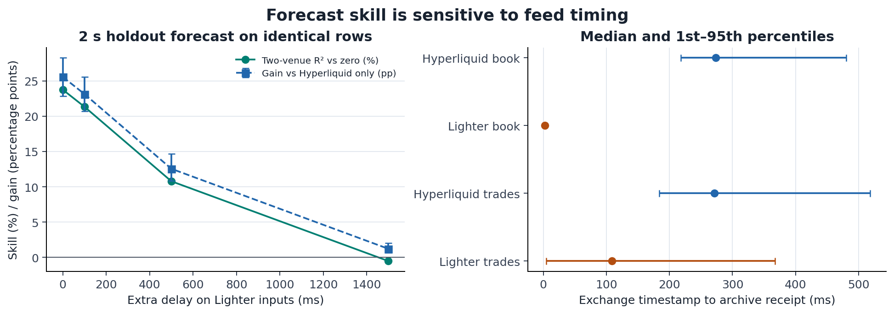
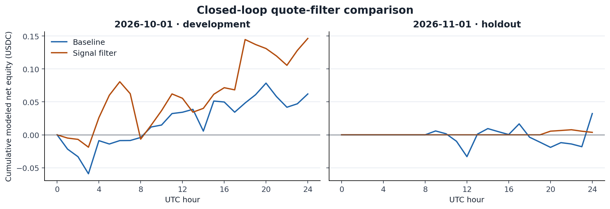
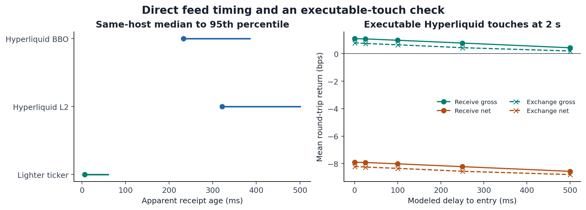
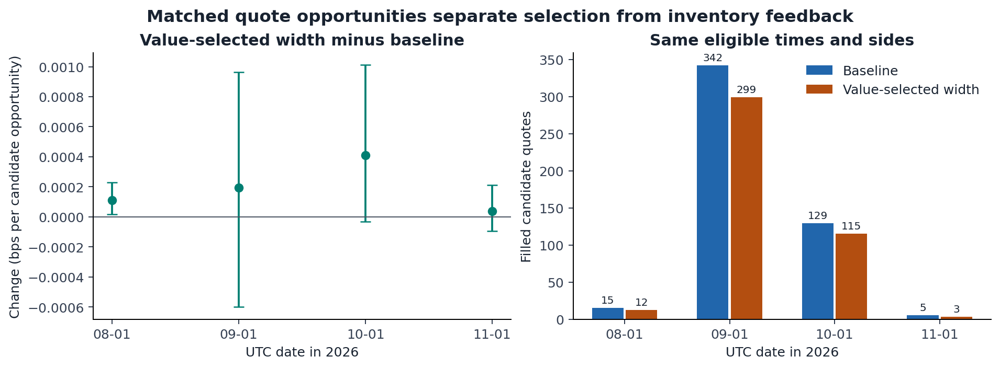
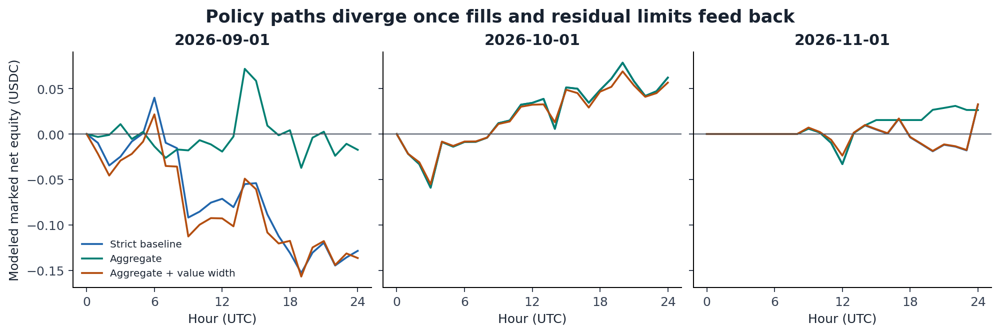
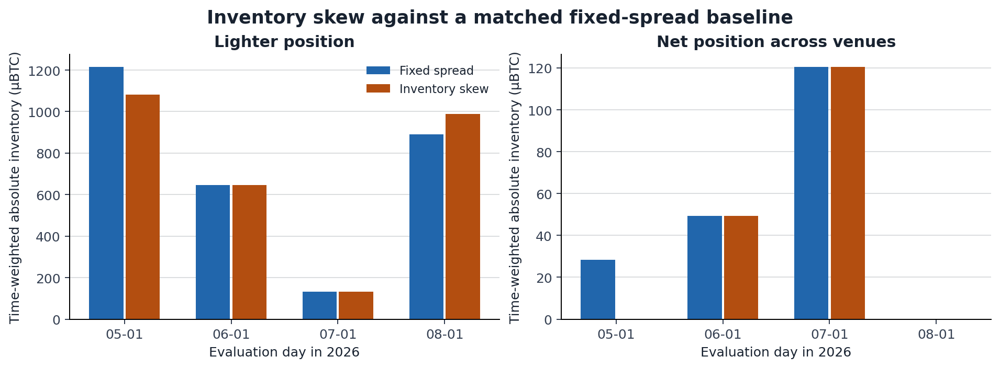

# Event-Driven MM

Event-Driven MM is a Rust market-making and execution research stack for **Lighter and Hyperliquid**, with Python tools for analyzing BTC perpetual markets. It records market data and order events, replays trading decisions deterministically, and lets you compare quote and hedge policies on the same historical tape. Use it to trace why an order was placed or canceled, see how partial fills affect inventory, and test how fees, latency, and queue assumptions change simulated execution.

The maker supports either venue on its own or a hedged mode that posts on Lighter and sends price-limited Hyperliquid immediate-or-cancel (IOC) orders after confirmed fills. Signed execution uses **testnet**. Historical studies use public market data, and calibration against signed fills remains open.

[Quick start](#quick-start) · [Architecture](#architecture) · [Execution simulator](#execution-simulator) · [Testnet workflows](#testnet-workflows) · [Research](#btc-short-horizon-research) · [Inventory benchmark](#inventory-skew-benchmark)

## Results at a glance

| Experiment | Finding |
|---|---|
| Replay performance | **15,445,257** historical book updates and trade prints across seven days. On three runs of a 2.23-million-event tape, median local processing after decoding was **0.572 µs** across both input types and **5.607 µs** for books alone. [Benchmark](#inventory-skew-benchmark) |
| Inventory skew | Time-weighted absolute Lighter inventory was **1.16% lower** than an unskewed fixed-spread baseline across four evaluation days. The paired 95% interval spanned **−9.83% to +9.94%**. [Inventory comparison](#historical-comparison) |
| Cross-venue signals | In a 15-minute same-host capture, adding Lighter data raised two-second Hyperliquid midpoint forecast R² from **10.09% to 25.15%** using exchange-timestamped outcomes. All **420** selected directional round trips lost money after modeled fees, and quote widening showed mixed PnL effects in closed-loop replay. [Timing study](#direct-feed-timing) · [Policy replay](#closed-loop-replay) |

## Quick start

From the repository root with a stable Rust toolchain, try these commands with the bundled journals. Both run offline and require no exchange credentials.

```sh
# Verify a recorded place, rest, and cancel sequence.
cargo run --locked -- replay --log tests/fixtures/order-session.jsonl

# Compare five execution scenarios on the same sample tape.
cargo run --locked -- simulate --log tests/fixtures/sim-public.jsonl \
  --config examples/simulation.json --mode closed-loop --seed 71
```

The first command regenerates the placement and cancellation intents and reports `verified_canceled`. The simulator prints JSON with per-scenario fills, hedging outcomes, inventory exposure, and modeled PnL.

| To | Use |
|---|---|
| Record public Hyperliquid order-book snapshots and print midpoints | `capture` |
| Verify a session offline and regenerate recorded order intents | `replay` |
| Record Lighter and Hyperliquid feeds without submitting orders | `maker --observe` |
| Exercise signed execution on testnet | `order-test` for one Hyperliquid order or `maker` for market making |
| Inspect feed timing, fills, and hedge completion in a maker journal | `inspect-maker` |
| Compare alternative execution policies on a finished hedged journal | `simulate` |
| Export receipt-timed books, trades, order events, and fills for analysis | `research-export` |

### Capture a public Hyperliquid book

The `capture` command is the single-feed workflow. It records one public `l2Book` subscription. Each usable snapshot emits a `local_time_unix_ms,mid_price` row, even when the midpoint stays the same. A capture requires a new journal path and writes diagnostics to stderr.

```sh
work=$(mktemp -d)
cargo run --locked -- capture --coin BTC --duration-secs 30 --log "$work/btc.jsonl" > "$work/live.csv"
cargo run --locked -- replay --log "$work/btc.jsonl" > "$work/replay.csv"
test -s "$work/live.csv" && cmp "$work/live.csv" "$work/replay.csv"
```

## Architecture

- **Transport.** A Mio reactor handles nonblocking TCP, TLS, and WebSocket I/O. Command queues wake the reactor when work arrives, and connections retain unwritten bytes until the socket is ready. Public capture follows the journal through a file-backed queue that handles partial records and temporary EOF. [Reactor](src/network/reactor.rs) · [Queues](src/queue.rs)
- **Maker engine.** The testnet maker journals normalized books, account snapshots, fills, order updates, and timers, then applies each input to the engine. It records the resulting intents before dispatch. The same engine powers offline verification and the execution simulator. [Maker runtime](src/network/maker.rs) · [Maker engine](src/maker.rs)
- **Research export.** `research-export --log maker.jsonl` verifies a maker journal and emits top-five books, detailed trades, order intents, updates, and confirmed fills as JSONL. Records retain source sequence IDs and monotonic availability timestamps for point-in-time analysis. [Research export](src/research_export.rs)

### Journals and timing

Journals are newline-delimited JSON and replay follows their recorded sequence order. Public capture journals begin with `session_start` and preserve WebSocket payloads above TLS. Maker journals begin with `maker_start` and record the effective config, normalized inputs, intents, and terminal state. Current maker journals use v5, which adds trade price, size, and aggressor side. Replay also reads v4 maker journals and earlier capture and order-test formats. Signing keys, request signatures, and authentication tokens stay out of the journal. [Event schema](src/event.rs) · [Journal](src/journal.rs)

`capture --latency` and `order-test --latency` show sample counts and approximate p50, p95, and p99 for available stages such as receive-to-read, read-to-decode, journal-to-engine, first socket write, and signed journal sync. Linux can supply a kernel timestamp for the receive batch that completed the message. macOS uses userspace timestamps. Recorded timer events carry scheduled and actual firing times and skipped intervals where applicable. Replay processing time is measured separately with `simulate --measure-processing`, which times local handling of already-decoded market events without trace output. [Latency instrumentation](src/latency.rs) · [Receive timestamps](src/network/rx_timestamp.rs)

### Inventory skew

Let `m` be the midpoint of the maker venue's best bid and ask, `q` the signed position on that venue, and `I` the configured `max_inventory`. The flat distance from midpoint to either quote is the **half-spread** `s = m × half_spread_bps / 10,000`. The inventory fraction is `x = min(|q| / I, 1)`.

| Quote side | Change to the flat distance | Distance used by the skew function |
|---|---|---|
| Increases inventory in the current direction | Widen by `s × x / (1 − x)` | `min(s + s × x / (1 − x), m / 2)` for `x < 1` |
| Reduces inventory | Tighten by `s × x` | `s − s × x` |

The bid subtracts its distance from `m`. The ask adds its distance to `m`. A long position widens the bid and tightens the ask. A short position tightens the bid and widens the ask. At `x = 0` both distances equal `s`. At or beyond the inventory cap, the increasing quote is suppressed before division and the reducing quote's raw distance is zero. For example, at `m = 100`, `s = 1`, and half the inventory cap, a long position gives a raw bid of `98` and ask of `100.50`. A short position gives a raw bid of `99.50` and ask of `102`.

In single-venue mode the skewed midpoint prices are the raw quotes. In hedged mode `q` is the Lighter position. The strategy applies the difference between the skewed and flat midpoint prices to a flat quote first bounded by the executable Hyperliquid hedge price, fees, required edge, and slippage allowance. The final price still respects the hedge and post-only bounds, with bids rounded down and asks up to valid prices. Size also respects inventory, venue lot, and notional limits. [Skew and quote calculation](src/maker/strategy.rs)

### Maker state-machine separation

| Component | Input and responsibility | Output |
|---|---|---|
| Market-state tracking | `State::apply` consumes normalized books, account snapshots, order updates, fills, connection events, and ticks. `State::sent` tracks an emitted intent as pending. | Observed books, positions, available collateral, and tracked order state, including pending actions. [Market-state reducer](src/maker/state.rs) |
| Strategy decision-making | `strategy::desired` reads the state and configuration, then applies freshness and risk checks, pricing, and inventory skew. | Desired bid and ask prices and sizes, or an absent quote on either side. [Quote strategy](src/maker/strategy.rs) |
| Order reconciliation | `execution::reconcile` compares the desired quotes with tracked orders, including pending placement, working orders, pending cancellation, and terminal orders still awaiting reported fills. | Place or cancel actions. Replacement waits until the previous order on that side is terminal and its reported fills are accounted for. [Order reconciliation](src/maker/execution.rs) |

`Engine::apply` applies the recorded input, evaluates eligible hedge actions, computes desired quotes, and reconciles them against tracked orders. Emitted intents carry the triggering journal sequence and an ordinal within that input, and immediately update the pending state. Replay runs the same engine and compares the full ordered intent stream and final result against the journal. [Engine orchestration](src/maker.rs) · [Replay verification](src/maker/diagnostics.rs) · [Inventory and order lifecycle tests](src/maker/tests.rs)

## Execution simulator

The simulator verifies the source journal's recorded intents and replays the market tape under a configurable set of execution policies.

- **Closed loop** (`--mode closed-loop`) simulates Lighter orders and fills as well as Hyperliquid hedges. Acknowledgments, partial fills, and cancellations change the strategy's next decisions. Use a finished v5 hedged maker journal with detailed Lighter trades.
- **Fixed fills** (`--mode fixed-fills`) keeps the recorded Lighter maker fills from a signed capture and simulates Hyperliquid execution. V4 journals can support the IOC comparison. Passive hedging requires detailed Hyperliquid trades.

The example model compares IOC and passive-then-IOC hedges with different latency, fee, and queue assumptions. The first scenario is the reference for PnL deltas. Choose explicit `fees_bps` for an observe-only tape or use `null` to use the recorded instrument fees from a signed capture. Set `inventory_skew` to `false` in a simulation scenario for an unskewed baseline with the same risk bounds. An optional `--trace` captures intents, acknowledgments, and fills, while `--measure-processing` records timing distributions with tracing off. [Example simulation model](examples/simulation.json)

An IOC consumes displayed depth within its price limit. Passive orders join behind displayed size and fill against eligible prints. At the same simulated timestamp, prints precede order arrivals and cancels. The `cancel_ahead` setting controls how much unexplained displayed size reduction is credited ahead of a resting order. Gaps pause matching until a snapshot restores the book. [Matching model](src/sim/execution.rs)

The simulator uses recorded public quotes as a proxy for venue state, assumes small orders, and excludes market impact, margin dynamics, and funding. Ending positions are marked to the last valid venue mids. Results include quote and hedge fills, time-weighted inventory, unresolved orders, in-flight events, modeled PnL, and the extra taker fee that would offset a scenario’s positive PnL difference from the baseline. [Report metrics](src/sim/report.rs)

For comparison with recorded testnet fills, see [calibration](#reproduce-and-calibrate).

## Testnet workflows

### Observe and inspect both venues

The sample maker configuration sets `coin` to `BTC` and `lighter_market` to `4096` on testnet. The supported modes are `hyperliquid`, `lighter`, and `hedged`. For Hyperliquid-only mode, set `"lighter_market": null`. Observe mode reads the configured testnet feeds and submits zero orders. [Example maker configuration](examples/maker-testnet.json)

```sh
work=$(mktemp -d)
cargo run --locked -- maker --config examples/maker-testnet.json \
  --observe --duration-secs 30 --log "$work/observe.jsonl"
cargo run --locked -- replay --log "$work/observe.jsonl"
cargo run --locked -- inspect-maker --log "$work/observe.jsonl"
```

Use `inspect-maker --step` to walk the journal, or `--feed-copies` on the observe command to compare redundant feed arrivals. The inspection report includes book and trade timing, maker fill markouts at 100 ms, 1 second, and 5 seconds, hedge completion and latency, and matched fill edge after fees. A 24-hour observe soak can use `--duration-secs 86400`.

### Test one Hyperliquid order

Set `HYPERLIQUID_TESTNET_AGENT_KEY` to the approved API wallet key for an isolated funded testnet account. Use its public address for `--account` and choose a price and size that meet the venue limits and your configured notional cap. Run each capture with a fresh journal path.

```sh
work=$(mktemp -d)
cargo run --locked -- order-test --account "$TESTNET_ACCOUNT" --coin "$TESTNET_COIN" \
  --price "$TESTNET_PRICE" --size "$TESTNET_SIZE" --max-notional "$TESTNET_MAX_NOTIONAL" \
  --log "$work/order-test.jsonl" > "$work/order-test.txt"
cargo run --locked -- replay --log "$work/order-test.jsonl" > "$work/order-replay.txt"
cmp "$work/order-test.txt" "$work/order-replay.txt"
```

The smoke test waits for evidence that the order rested, cancels by client order ID, and checks the authoritative outcome. Success requires a verified cancellation, exactly one cancel intent, and a flat position. After an ambiguous response, it queries the original client order ID and can reconnect for cleanup. If the test returns an unresolved order, use the reported client order ID to check testnet before starting another run.

### Run the hedged maker on testnet

Signed sessions run on macOS and Linux. Use dedicated funded testnet accounts with flat positions and no working orders in the configured instrument. Set `HYPERLIQUID_TESTNET_AGENT_KEY` for Hyperliquid. For Lighter, set `LIGHTER_TESTNET_API_KEY` for the chosen API key index and `LIGHTER_TESTNET_SIGNER_LIB` to the matching platform library. Run one process per account and Lighter API key index. [Official Lighter signer library](https://github.com/elliottech/lighter-python/tree/v1.1.9/lighter/signers)

```sh
work=$(mktemp -d)
cargo run --locked -- maker --config examples/maker-testnet.json \
  --hyperliquid-account "$TESTNET_ACCOUNT" \
  --lighter-account "$LIGHTER_ACCOUNT_INDEX" --lighter-key-index "$LIGHTER_API_KEY_INDEX" \
  --duration-secs 60 --log "$work/hedged-testnet.jsonl"
```

The maker prices against executable hedge depth and manages one post-only maker order per side. It cancels resting quotes when books or connections go stale and reconciles accounts and orders before quoting again. Shutdown cancels and reconciles orders on duration expiry, Ctrl-C, or SIGTERM. Hedged sessions report failure if residual exposure, unresolved orders, or unverified accounts persist past the recovery deadline. IOC hedging is the default. The optional passive-then-IOC policy requires acknowledged Hyperliquid scheduled cancellation, then waits for confirmed cancellation and outstanding fill reports before taking the remainder.

## Tests

```sh
cargo test --locked
python -m unittest research.test_research
```

Rust tests use local TLS peers and fixture journals to exercise replay parity, order lifecycle races, partial writes, timers, receive timestamps, and lost replies. Install the [pinned Python dependencies](research/requirements.txt) before running the research tests. The optional Lighter signer ABI test uses the official shared library and signs without submitting an order. Run it with `LIGHTER_TESTNET_SIGNER_LIB` set and `cargo test --locked signs_with_the_official_lighter_library -- --ignored`.

## BTC short-horizon research

The November holdout forecast reduced squared error by **23.2%** versus the zero-return baseline at a two-second horizon. Lighter alone scored **24.1%** and Hyperliquid alone scored **−2.3%**. The forecast advantage shrank sharply when Lighter data was delayed. Execution results below use the frozen forecast to test whether that information improves Lighter quoting.

### Data and split

The study uses 96 hours of matched BTC perpetual data from four full UTC days. Hyperliquid is `BTC` and Lighter is market `1`. The inputs are Tardis top-five book snapshots and public prints with exchange and provider receipt timestamps. The archive's provider receipt time is the primary information clock. The [data manifest](artifacts/research/data_manifest.json) records source URLs, SHA-256 checksums, row counts, and timestamp audits. Trade counts reflect valid, deduplicated prints. [Tardis dataset format and receipt clock](https://docs.tardis.dev/downloadable-csv-files/api-reference) · [Lighter market metadata](https://docs.lighter.xyz/api/orders/orderbookdetails.md)

| UTC day | Role | Hyperliquid books / trades | Lighter books / trades | Eligible feature rows |
|---|---|---:|---:|---:|
| 2026-08-01 | Initial training | 148,632 / 125,555 | 905,164 / 718,525 | 710,709 |
| 2026-09-01 | Forward validation and threshold calibration | 156,735 / 360,024 | 1,051,743 / 656,952 | 790,380 |
| 2026-10-01 | Forward validation and development execution check | 155,773 / 294,078 | 1,091,732 / 575,837 | 779,509 |
| 2026-11-01 | Final holdout | 147,340 / 163,640 | 899,210 / 525,545 | 657,101 |

### Forecast design

1. Align both venues on a 100 ms grid using observations received by each decision time. Deduplicate public trades by venue and ID. Reject crossed, invalid, or stale books. Require a maximum book age of 750 ms and end the continuous segment after book gaps exceeding two seconds. Use the same eligible rows for every model in a comparison.
2. Build top-level and five-level depth imbalance, microprice offset, spread, depth, signed trade flow, trade notional, recent returns, book age, and cross-venue mid divergence. Flow and return windows are 250 ms, 1 s, and 5 s. The target is `10,000 × log(Hyperliquid mid at t+h / mid at t)`. Require fresh endpoint observations from the same Hyperliquid segment. Lookbacks and labels stay within the daily file. [Feature inspiration from Albers et al.](https://arxiv.org/html/2108.09750#S3)
3. Fit ridge regression on expanding earlier days. Standardize from training moments only and use a fixed penalty of 0.01 on the mean standardized loss. Compare zero return, each venue alone, both venues, and ablations for trade flow and basis. The primary metric is `1 − SSE(model) / SSE(zero)`. Report paired 95% intervals for incremental skill from 2,000 resamples of 30-minute time blocks. The intervals describe within-day uncertainty on these samples.
4. Repeat the comparison with 100, 500, and 1,500 ms added to Lighter receipt times, using common holdout rows. Run a separate diagnostic with both venues placed on their exchange timestamps plus a common 500 ms delay. Exchange clocks and batching differ, so that diagnostic is a timing stress test.


| November horizon | Labeled rows | Hyperliquid (R²) | Lighter (R²) | Both (R²) | Both vs Hyperliquid, paired 95% interval | Both RMSE |
|---|---:|---:|---:|---:|---:|---:|
| 500 ms | 623,524 | −1.12% | 18.84% | 18.92% | +17.21 to +22.77 pp | 0.148 bps |
| 2 s | 619,854 | −2.33% | 24.13% | 23.22% | +23.02 to +28.16 pp | 0.324 bps |
| 5 s | 615,767 | 1.72% | 15.17% | 16.12% | +12.70 to +16.23 pp | 0.577 bps |

The two-venue 2 s model scored **32.69%** in September and **41.22%** in October. On November's common delay sample it went from **23.76%** with observed receipt timing to **21.34%**, **10.78%**, and **−0.53%** with the three added delays. The equal-delay exchange-clock diagnostic scored **14.59%** at 2 s on its own eligible sample. The November 2 s holdout had a nonzero return on 12.3% of eligible rows. The full model's conditional direction hit rate was 91.2% on those moves. The trade-flow ablation scored 23.52%, above the full model by 0.30 percentage points. [Full forecast results](artifacts/research/forecast_results.json) · [Held-out coefficients and training days](artifacts/research/model_coefficients.json)



### Quote-filter experiment

The action rule was fixed from the September predictions. Suppress or cancel the Lighter buy when the 2 s forecast is at or below **−0.52816 bps**, and the sell when it is at or above **+0.52816 bps**. This is the 90th percentile of absolute September predictions. The engine uses only forecasts already available and at most 250 ms old. October and November each get forecasts trained on earlier days. The filter runs in the simulator and the live maker defaults are unchanged.

Both variants use the same **0.00030 BTC** order lot, 0.50 bps required edge, 1 bps slippage allowance, $100 order-notional cap, 0.0015 BTC per-venue inventory cap, 0.00060 BTC portfolio residual cap, and a 5 s residual-age limit. The experiment uses 0 bps Lighter maker and 4.5 bps Hyperliquid taker fees as explicit assumptions. The primary model uses 12 ms each way, up to 2 ms of seeded jitter, and zero cancellation credit ahead of a resting order. Two paired sensitivity cases credit 50% of unexplained queue decreases or increase delay to 150 ms each way. Those assumptions are in the [frozen simulator configuration](artifacts/research/quote_filter_model.json).

Each day was replayed end to end with simulated acknowledgments, fills, retries, and inventory feedback. An archived print can fill a resting order only if its exchange timestamp follows modeled order arrival. Decisions see archived receipt-time snapshots. Quote opportunity traces record the first placement-eligible observation in each 100 ms bucket per side. Filled, unfilled, and unresolved placements are joined by client order ID. The independent Python ledger reconciled final net PnL with Rust before charting. Equity includes modeled fill fees and marks ending inventory at each venue's last valid mid. Funding is excluded.

| UTC day and case | Baseline net PnL | Filtered net PnL | Paired change | 95% interval | Filled quote orders, baseline → filter |
|---|---:|---:|---:|---:|---:|
| Oct 1 · primary | +0.0620 | +0.1463 | +0.0842 | −0.2106 to +0.3451 | 19 → 2 |
| Oct 1 · 50% queue cancellation credit | +0.0620 | +0.1463 | +0.0842 | −0.2106 to +0.3451 | 19 → 2 |
| Oct 1 · higher latency | −0.0718 | +0.0302 | +0.1020 | −0.0804 to +0.3202 | 13 → 4 |
| Nov 1 · primary holdout | +0.0323 | +0.0038 | −0.0285 | −0.1829 to +0.1126 | 7 → 1 |
| Nov 1 · 50% queue cancellation credit | +0.0323 | +0.0038 | −0.0285 | −0.1829 to +0.1126 | 7 → 1 |
| Nov 1 · higher latency | +0.0217 | +0.0221 | +0.0004 | −0.1521 to +0.1332 | 4 → 6 |

PnL and intervals are in USDC. Execution intervals resample 12 non-overlapping two-hour blocks of paired hourly equity changes within each day. They describe the observed simulation path and model assumptions. The queue sensitivity produced identical outcomes on these paths and provides limited evidence about actual queue position. [Full execution and fill-quality results](artifacts/research/execution_results.json)



#### Fill quality and exposure

| Primary baseline cohort on Nov 1 | Quote placements | Filled orders | Eligible fill markouts | Size-weighted 2 s markout |
|---|---:|---:|---:|---:|
| Forecast flagged adverse at placement | 483 | 4 | 4 | −6.55 bps |
| Fresh forecast, below threshold | 3,280 | 3 | 4 | −7.00 bps |
| No fresh forecast | 712 | 0 | 0 | — |
| Filtered strategy, all placements | 9,170 | 1 | 1 | −8.86 bps |

The markout is the side-signed Hyperliquid mid move from the modeled Lighter fill observation to two seconds later. Negative values indicate adverse movement. Orders can produce multiple fills. On October's primary baseline, flagged fills had a **−6.70 bps** markout across 11 eligible fills, versus **−4.54 bps** across nine unflagged fills. November's eight eligible baseline fills reversed that ranking.

Residual inventory dominated several paths. The October filter left **0.00010 BTC** unhedged for **23.85 hours**, and the November baseline left **0.00009 BTC** for **10.38 hours**. Those amounts were below the modeled $10 Hyperliquid minimum. The residual-age guard stopped new maker exposure, which explains much of the difference in quoting activity. The November filter finished flat and sent **9,170** cancels against **4,470** for the baseline in the primary case.

**Decision.** Keep the filter out of live quoting. Lighter adds short-horizon predictive information on this archive, but the fixed filter reduced primary holdout PnL, increased cancellation churn, and failed to consistently separate adverse fills. The holdout sample of strategy fills is small. The archive also showed median exchange-to-receipt book lags of about **274 ms** on Hyperliquid and **2.6 ms** on Lighter, so archive predictability is sensitive to routing and feed construction. Signed fill and hedge calibration remains open. These replays use aggregate public depth and assumptions about queue position, fee rates, latency, collateral, and small-order market impact. The study covers four first-of-month days and one instrument.

## Follow-up · Timing, hedge residuals, and quote value

The follow-up uses three separate comparisons. Direct public feeds test the age of information on one host. Matched quote opportunities test selection while holding time, side, and offered size fixed. Closed-loop replays allow fills, cancellations, and residual inventory to change later decisions. Each comparison uses its own outcome and sample.

### Direct feed timing

`research.timing` subscribes to Hyperliquid BTC BBO and L2 and Lighter BTC ticker from one process on one host. It records a monotonic receive timestamp and a wall-clock reading immediately after each message is returned. The apparent exchange-to-receipt age includes exchange timestamp semantics, batching, network transit, and local scheduling. The monotonic timestamp determines when quotes become available to the analysis. [Hyperliquid public WebSocket feeds](https://hyperliquid.gitbook.io/hyperliquid-docs/for-developers/api/websocket/subscriptions) · [Lighter public WebSocket feeds](https://docs.lighter.xyz/api/websocket.md)

The November 23 capture ran for **15 minutes starting at 21:51 UTC** with zero reconnects. Hyperliquid BBO had **7,240** valid updates, with apparent age **233 ms median / 385 ms p95**. Lighter ticker had **44,659**, at **6.3 / 59.7 ms**. Hyperliquid L2 had only **74** updates, with a median inter-update gap of **12.36 seconds**. It yielded too few fresh rows for the forecasting comparison. [Capture and timing results](artifacts/research/followup/timing.json) · [Normalized public quotes](artifacts/research/followup/local-quotes.jsonl.gz)

The analysis fits fixed ridge models on the first half, purges labels that overlap the split, and evaluates the second half. The exchange-clock diagnostic dates each Hyperliquid outcome using its exchange timestamp and the host’s recorded wall clock. Both versions use the same train and holdout decisions, and all features are drawn from quotes already received at decision time. The exchange clock is an observational check subject to timestamp semantics and cross-host clock skew.

| Horizon | Outcome clock | Holdout decisions | Hyperliquid-only R² | Lighter-only R² | Both venues R² |
|---|---|---:|---:|---:|---:|
| 500 ms | Receive | 4,410 | 12.57% | 26.23% | 42.32% |
| 500 ms | Exchange | 4,410 | 7.35% | 32.08% | 39.36% |
| 2 s | Receive | 4,409 | 14.72% | 22.66% | 38.80% |
| 2 s | Exchange | 4,409 | 10.09% | 14.75% | 25.15% |

R² is relative to predicting zero return. The two-second advantage of both venues over Hyperliquid alone fell from **24.08 to 15.06 percentage points** when outcomes were dated by exchange time. The exchange-clock improvement had a **9.6 to 18.7 point** paired interval across eight one-minute blocks. One host and one brief sample leave routing and time-of-day sensitivity unresolved.

The executable-touch diagnostic uses the same **420** two-second signals across clocks and entry delays. It selects signals above the 90th percentile of absolute forecasts in the training half. The position crosses the Hyperliquid touch at modeled arrival and crosses back at the forecast horizon, at **4.5 bps per leg**. Using exchange timestamps for the touches, mean gross return fell from **+0.80 bps** at zero modeled entry delay to **+0.20 bps** at **500 ms**. Net return was **−8.20** and **−8.80 bps** respectively, with zero net-positive rows at any tested delay. The sample establishes a midpoint timing result and measures the cost of a standalone directional round trip. The Lighter maker and Hyperliquid hedge trade has different costs and is evaluated below.



### Matched execution value

Seven first-of-month BTC archive days from May through November 2026 supply **168 hours** of public books and trades. May through July provide initial training, then August through November are scored with models fit only on earlier days. Every five seconds the study builds a hypothetical bid and ask using a Lighter top-five book and Hyperliquid hedge depth. Each eligible time and side shares the same offered lot of **0.00030 BTC** across three candidate widths, **0, 0.25, and 0.50 bps** wider than the base quote. [Source and sample audit](artifacts/research/followup/execution_value.json)

The label allows two seconds at the modeled order price. A print must be on the opposing side and occur after modeled quote arrival. Exact-price prints consume displayed queue ahead first. Trade-throughs clear that queue, and partial fills are capped by print volume. The label uses the last partial fill and a modeled hedge arrival to price the IOC against five levels and charges both legs’ fees. Unhedged quantity is reported and valued at the terminal executable touch with a taker fee allowance. This terminal valuation can apply to quantity below the order minimum. It represents marked inventory, with simulated hedge completion reported separately.

A regularized logistic model estimates fill probability. A second ridge model estimates net bps conditional on a fill, normalized by offered notional. Their product ranks the candidate widths. Features include the quote’s cross-venue edge, distance from mid, displayed depth, imbalance, short returns, and signed flow. The independent candidate labels omit inventory history. The comparison includes unfilled opportunities with zero value and keeps common groups with known labels for all candidates. A 30-minute paired block bootstrap measures sampling sensitivity within each day. The results file also includes fixed-width controls and fill probability calibration by score quintile.

| Held-out UTC day | Matched times and sides | Filled candidates, base → value width | Change in modeled net bps per opportunity | Paired 95% interval |
|---|---:|---:|---:|---:|
| Aug 1 | 28,568 | 15 → 12 | +0.000110 | +0.000018 to +0.000229 |
| Sep 1 | 31,530 | 342 → 299 | +0.000193 | −0.000601 to +0.000963 |
| Oct 1 | 31,374 | 129 → 115 | +0.000411 | −0.000033 to +0.001012 |
| Nov 1 | 26,482 | 5 → 3 | +0.000036 | −0.000096 to +0.000212 |

On November 1 the base-width fill model had average precision **0.0239** at **0.000189** fill prevalence, with a Brier score of **0.000232** versus **0.000239** for the constant baseline. Value selection improved the marked result per filled candidate from **0.74 to 1.55 bps**, on five and three fills respectively. Both fixed widening controls earned slightly more per opportunity than model-selected width on that day, with three fills each. The wide interval and low event count limit confidence in the final fold.



### Residual and quote-width policies

`strict` retains the original residual-age guard. Recovery is opt-in. The two bounded modes relax the quote pause only when the residual is below Hyperliquid’s rounded lot or minimum notional at both the touch and modeled IOC limit, the books and account are healthy, and there is no unresolved hedge. The experiment caps recovery at **0.00020 BTC** and **30 minutes** of same-sign residual age.

- `bounded_reduce` allows an opposing quote only, capped at twice the residual so a fill on that quote cannot increase its absolute size. If the capped quote misses a market minimum, it stays off.
- `bounded_aggregate` permits continued quoting under existing inventory, notional, liquidity, and worst-case residual limits. Hedgeable exposure still uses the existing IOC policy.
- `larger_lot` compares **0.00050 BTC** under strict recovery. Smaller partials can still leave a residual below the minimum.
- `value_widen` uses the same bounded aggregation as its control and widens the bid or ask by the prior-day model's chosen offset. The latest action is eligible for five seconds. Widening follows the usual cancel-and-replace lifecycle, and exchange and risk bounds still apply.

A session end still requires reconciled orders and exactly zero net residual. The research action file is read only by `simulate`. The maker accepts explicitly configured residual policies and defaults to `strict`.

### Closed-loop replay

Each scenario starts flat and consumes the same receive-timed public books and trades on September 1, October 1, and November 1. The paired run covers **72 distinct archive hours** across seven scenarios. The primary setting models **12 ms each way** with up to **2 ms** of seeded jitter. The latency stress uses **150 ms each way**. It charges the archive’s assumed **0 bps** Lighter maker and **4.5 bps** Hyperliquid taker fees. Terminal equity marks each venue’s remaining position to its last valid midpoint and excludes funding. The report reconciles this equity to an independent fill ledger and records order fill rates, post-fill markouts, hedge times, cancellation churn, turnover, and hourly drawdown. Paired intervals resample two-hour blocks within each day.

| Replay policy | Sep 1 PnL (USDC) / filled orders | Oct 1 PnL (USDC) / filled orders | Nov 1 PnL (USDC) / filled orders |
|---|---:|---:|---:|
| Strict baseline | −0.1286 / 2 | +0.0620 / 19 | +0.0323 / 7 |
| Larger lot | +0.0164 / 13 | +0.0653 / 16 | +0.0850 / 13 |
| Bounded reduction | −0.1286 / 2 | +0.0620 / 19 | +0.0323 / 7 |
| Bounded aggregation | −0.0174 / 9 | +0.0620 / 19 | +0.0263 / 13 |
| Aggregation + value width | −0.1365 / 6 | +0.0565 / 18 | +0.0327 / 5 |
| Bounded aggregation at 150 ms | +0.0196 / 16 | −0.0718 / 13 | −0.0081 / 13 |
| Aggregation + value width at 150 ms | +0.0276 / 15 | +0.0379 / 20 | −0.0109 / 10 |

Bounded aggregation shortened the longest November residual episode from **10.38 hours to 24.2 minutes** and finished flat. In September it shortened the longest episode from **23.43 to 10.89 hours** and still ended with **0.00010 BTC** outstanding. Reduction-only left the same filled-order counts, residuals, and PnL as the strict baseline on all three days. Larger lots raised marked PnL on all three days and raised peak net exposure from **0.00030 to 0.00050 BTC**. The larger-lot PnL intervals all included zero, and it ended October with a **0.00007 BTC short** residual.

Value widening under primary latency changed PnL versus aggregation alone by **−0.1191**, **−0.0055**, and **+0.0064 USDC** in chronological order. All paired intervals included zero. At 150 ms per leg the changes were **+0.0080**, **+0.1097**, and **−0.0028 USDC**, with all intervals again including zero. In the primary November run, widening reduced filled orders from **13 to 5** and the 10.38-hour residual recurred. Fills and inventory feedback were large enough to reverse some of the matched-opportunity results. [Full replay metrics and paired intervals](artifacts/research/followup/closed_loop.json)



The forecasting gain survived the clock check on this short public sample. The fitted quote-width policy showed inconsistent after-fee improvement once inventory fed back into quoting. Bounded aggregation improved recovery on some paths, with outstanding exposure still possible after its age limit. These results support keeping value widening in replay and retaining strict recovery as the default while collecting signed fill and hedge evidence across more sessions.

### Reproduce and calibrate

Use Python 3.11 and the pinned research dependencies. The replay step builds a Rust release binary. To reproduce the timing results, pass `artifacts/research/followup/local-quotes.jsonl.gz` to `--log` in place of a fresh capture. The quote-value analysis downloads the seven public sample days. For the closed-loop comparison, build the September, October, and November archive journals before running the paired scenarios.

```sh
python3.11 -m venv .venv
. .venv/bin/activate
python -m pip install -r research/requirements.txt

work=$(mktemp -d)
python -m research.timing capture --seconds 900 --out "$work/local.jsonl"
python -m research.timing analyze --log "$work/local.jsonl" --out "$work/timing.json"

python -m research.execution_value --download --raw "$work/raw" \
  --work "$work/labels" --out "$work/values" \
  --verify-manifest artifacts/research/followup/execution_value.json
for day in 2026-09-01 2026-10-01 2026-11-01; do
  python -m research.archive --raw "$work/raw" --day "$day" --out "$work/$day.jsonl"
done
cargo build --release --locked
python -m research.followup closed-loop --raw "$work/raw" --work "$work" \
  --values "$work/values" --out "$work/closed"
cp "$work/values/execution_value.json" "$work/closed/closed_loop.json" "$work/"
python -m research.followup_charts --out "$work"
```

For venue calibration, use a finished signed testnet journal containing actual Lighter and Hyperliquid fills. Run fixed-fill comparisons with the journal’s instrument fees, fit assumptions using the calibration session, then check the same settings on another signed session. The checker requires a clean signed journal with fills on both legs and reports observed alongside simulated hedge completion, latency, residual exposure, and PnL.

```sh
./target/release/event-driven-mm simulate --log signed-testnet.jsonl \
  --mode fixed-fills --config research/calibration.json > signed-calibration.json
python -m research.followup calibrate --report signed-calibration.json
```

Signed fill calibration remains pending. This run had no funded testnet credentials, and the direct capture used only public feeds. The offline signer test exercised signing without submitting orders.

## Inventory skew benchmark

The comparison replays BTC perpetual books and trades from Lighter and Hyperliquid with two quoting policies. Both start each day flat and use the same 0.00030 BTC order lot, hedge IOC, fees, price and inventory limits, order lifetime settings, and modeled 12 ms one-way delay with up to 2 ms of seeded jitter. The fixed-spread baseline applies the configured 0.25 bps nominal half-spread with zero price skew. Both policies still obey the executable hedge bound, exchange rules, and inventory limits. Each policy receives its own simulated fills and carries its own inventory through the day.

September through November 1 were pilot tapes. The separate evaluation uses May through August 1, all selected before running this comparison. Those dates were used in earlier signal research. They are new to this paired inventory experiment. The archive provider’s Lighter BTC data starts on April 17, 2026, and the public sample files are available for the first of each month. [Lighter dataset coverage](https://api.tardis.dev/v1/exchanges/lighter) · [Archive access](https://docs.tardis.dev/downloadable-csv-files/api)

Market-event counts include nonempty book updates and eligible deduplicated trade prints submitted to the simulator. The shared tape is counted once per day across policies. The report tracks empty book inputs, timer ticks, order updates, and fill messages separately.

The primary outcome is time-weighted mean absolute Lighter inventory. For each interval, the simulator multiplies the magnitude of the Lighter position by the elapsed time. It sums the products and divides by the total replay duration, including the flat periods and the interval after the last fill. The same calculation on the sum of both venues’ signed positions measures net unhedged inventory. Relative reduction is the difference from baseline divided by baseline. The 95% interval resamples whole paired days and has limited resolution with four evaluation days. The report also keeps filled orders, volume, after-fee marked PnL, and leave-one-day-out estimates.

The processing benchmark uses the skewed scenario on the full May 1 tape, repeated three times on one host. A monotonic clock brackets one scenario's handling of each already-decoded market event, including any due simulated messages, matching, quote decisions, and scheduling. Trace serialization is disabled. Journal parsing, source verification, and network or exchange time are outside the measured interval. The simulator advances its market clock without sleeping. This measures elapsed host processing time during replay.

### Historical comparison

The seven days contained **15,445,257 historical market events**. The four evaluation days accounted for **9,366,648**, including **4,947,187 book updates** and **4,419,461 trade prints**. Each evaluation day contributes about 24 hours of exposure, including time without a position.

| Evaluation date (UTC) | Historical events | Fixed-spread mean absolute Lighter inventory (µBTC) | Skewed mean absolute Lighter inventory (µBTC) | Reduction |
|---|---:|---:|---:|---:|
| May 1 | 2,225,710 | 1,214.99 | 1,081.08 | +11.02% |
| Jun 1 | 2,468,194 | 646.05 | 646.05 | 0.00% |
| Jul 1 | 2,774,868 | 132.15 | 132.15 | 0.00% |
| Aug 1 | 1,897,876 | 889.41 | 989.85 | −11.29% |
| **Pooled** | **9,366,648** | **720.65** | **712.28** | **+1.16%** |

The paired 95% interval for the pooled reduction was **−9.83% to +9.94%**. Omitting May reversed the result to a **6.02% increase**. Mean absolute net unhedged inventory fell from **49.53 to 42.47 µBTC** in the evaluation and rose from **32.95 to 45.52 µBTC** in the pilot. The pilot Lighter inventory point estimate was **17.61% lower**, with an interval of **−31.21% to +57.91%**. The sample shows an observed reduction with substantial day-to-day variation.

On the four evaluation days, filled Lighter orders went from **39 to 45**, Lighter volume went from **0.01105 to 0.01308 BTC**, and marked PnL after fees went from **+0.0612 to +0.1262 USDC**. The economic outcomes are modeled from public depth and trade data.



### Measured processing time

Three serial release-mode runs on an Intel Core i5-1038NG7 Mac produced **6,677,130 timing samples** from **2,225,710 distinct May 1 market events**. The pooled median was **0.000572 ms**. The three individual medians were **0.563–0.582 µs**.

| Market input | Samples across three runs | p50 (µs) | p95 (µs) | p99 (µs) |
|---|---:|---:|---:|---:|
| Books and trades | 6,677,130 | 0.572 | 6.315 | 12.464 |
| Book updates | 3,288,417 | 5.607 | 7.250 | 22.131 |
| Trade prints | 3,388,713 | 0.147 | 0.284 | 0.723 |

Trade prints made up slightly more than half the timed input and processed faster than book updates. Benchmarked and untimed runs produced identical inventory, fill, and PnL results for May 1. [Full metrics, timings, and archive hashes](artifacts/research/inventory/inventory_benchmark.json)

### Reproduce the benchmark

Use the pinned Python 3.11 research dependencies installed above. The benchmark runner downloads the archive on request, builds missing v5 journals, runs the economic comparisons, then times three serial replays. It writes source and journal SHA-256 hashes, settings, counts, and results to JSON.

```sh
work=$(mktemp -d)
cargo build --release --locked
python -m research.inventory_benchmark --download --raw "$work/raw" \
  --journals "$work/journals" --out "$work/inventory"
```
